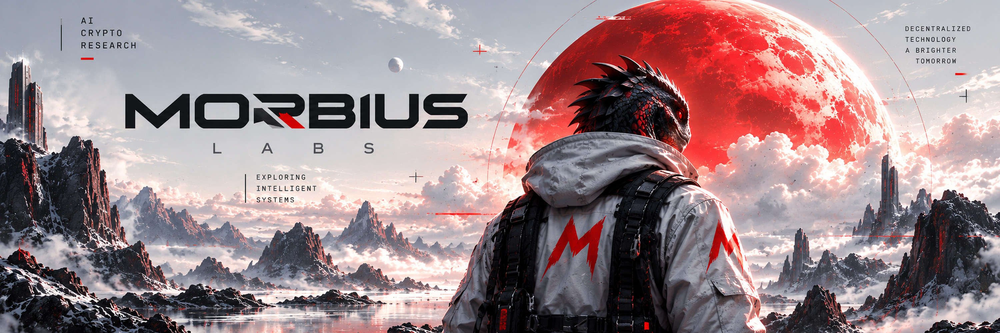

# MORBIUS LABS

### AI · CRYPTO · RESEARCH

Exploring intelligent systems, blockchain technology, and developer infrastructure.

[𝕏 Twitter](https://x.com/morbiusLabs) · [GitHub](https://github.com/morbiusLabs)

---

## About

Morbius Labs explores the intersection of artificial intelligence, blockchain technology, and decentralized infrastructure.

Our interests span applied research, intelligent automation, on-chain systems, and developer tooling.

## Focus Areas

**Artificial Intelligence**
- AI agents and automation
- Intelligent workflows
- Applied AI research

**Blockchain & Crypto**
- On-chain analytics
- Decentralized protocols
- Blockchain infrastructure

**Engineering**
- Developer tools
- Reproducible experiments
- Open-source research

## Projects

Research, experiments, and open-source projects will be published here as they become available.

## Connect

**X:** [@morbiusLabs](https://x.com/morbiusLabs)

**GitHub:** [morbiusLabs](https://github.com/morbiusLabs)

---

  MORBIUS LABS · AI × CRYPTO × RESEARCH

